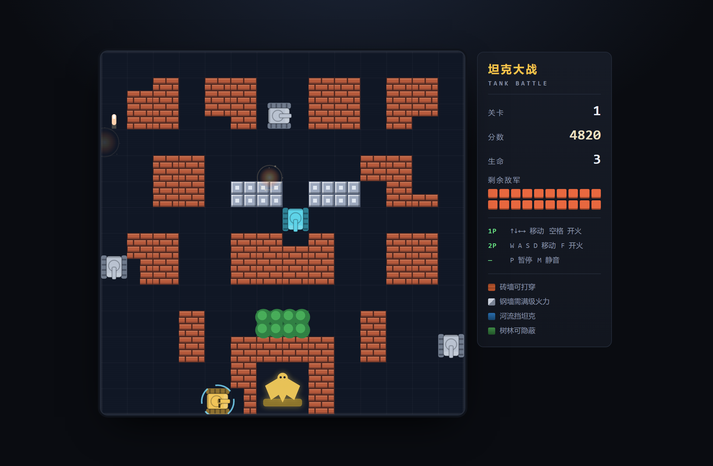

# 坦克大战 · Tank Battle

一个用原生 HTML + Canvas 2D 从零实现的经典坦克大战，**没有任何依赖、没有构建步骤**——双击 `index.html` 就能玩。



## 玩法

守住画面底部的基地（金鹰），消灭每一关的 20 辆敌军坦克。基地被击毁，或者三条命打光，游戏结束。

| 操作 | 1P | 2P |
| --- | --- | --- |
| 移动 | `↑` `↓` `←` `→` | `W` `A` `S` `D` |
| 开火 | `空格` | `F` |
| 暂停 | `P` | `P` |
| 静音 | `M` | `M` |

手机上会自动显示虚拟摇杆和开火键。

## 特性

- **局部可破坏的砖墙**：每格砖墙拆成 2×2 四个象限，子弹只打掉真正命中的那几块，能在墙上抠出射击孔。
- **四种地形**：砖墙可打穿；钢墙只有满级火力才破得开；河流挡坦克但子弹能飞过；树林可以通行，但会把坦克藏起来。
- **四种敌军**：普通、快速、火力型（双发高速弹）、装甲型（4 点血，血条画在车身上）。每关第 4、11、18 辆是闪光坦克，打掉会掉道具。
- **六种道具**：火力升级、护盾、时间冻结、全屏轰炸、额外生命、钢铁护墙。
- **三档火力**：1 级普通 → 2 级高速弹 → 3 级双发 + 可击穿钢墙。
- **5 张手绘关卡**，通关后可以进入二周目，敌军速度和同屏数量逐轮递增。
- **双人同屏**合作。
- **音效实时合成**：全部用 Web Audio 的振荡器和白噪声现场生成，仓库里没有任何音频文件。
- **手感细节**：转向时自动吸附到格线，钻 1 格宽的走廊不会卡住；敌军 AI 会主动冲基地、追玩家，也会随机游走。

## 运行

没有什么要装的：

```bash
git clone <仓库地址>
cd <仓库目录>
```

然后直接双击 `index.html`，或者起个静态服务器：

```bash
python -m http.server 8000
# 打开 http://localhost:8000
```

## 目录结构

```
index.html          页面骨架 + HUD
css/style.css       界面样式
js/levels.js        尺寸常量、瓦片类型、关卡地图
js/audio.js         Web Audio 音效合成
js/map.js           瓦片地图、砖墙局部破坏、碰撞查询
js/entities.js      坦克 / 子弹 / 爆炸 / 道具
js/game.js          状态机、主循环、渲染、输入
docs/screenshot.png README 用截图
```

代码用的是传统 `<script>` 标签（不是 ES module），所以直接从 `file://` 打开也能跑，不需要服务器。

## 实现要点

**固定步长主循环。** 逻辑固定按 1/60 秒推进，渲染跟着 `requestAnimationFrame` 走，切后台回来不会一次快进一大段。

**坦克与格线的对齐。** 坦克正好占一格，地图全在格线上。移动时垂直方向会自动朝最近的格线吸附（两条格线都走不通就反向），所以玩家不需要手动对齐就能穿过一格宽的缝隙。

**高速子弹不穿墙。** 子弹每帧按位移拆成若干子步推进，每一步都做一次碰撞检测，避免速度高时直接跳过薄墙。

**砖墙的象限位掩码。** 每格砖墙用一个 4 位掩码记录四块子砖是否还在，绘制时按存活的象限裁剪再画整格砖纹，所以打掉一半的墙看起来是无缝连续的。

## License

[MIT](LICENSE)
